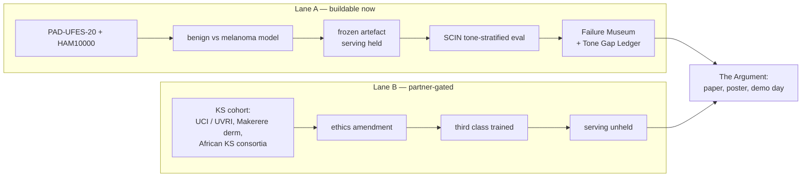

# The Kampala Roadmap: from a green test suite to a defensible study

**Written:** 2026-11-03 · **Horizon:** 12 weeks (to ~2027-01-26) + an open lane
**Owner:** J. Mutegeki · **Status:** active
**Printable version:** [`roadmap_wallchart.html`](./roadmap_wallchart.html) — A3
landscape, no external assets, print it and put it above the desk

---

## What "complete" means

Not "the app runs". Complete means six things exist, each with a file behind it:

1. a **frozen artefact** whose hash is in `model_manifest.json` and whose numbers
   come from a `report.json`, not from a slide;
2. a **tone-stratified evaluation** that publishes the ugly strata, with `n` and
   confidence intervals, including the strata where the model loses;
3. an **IRB determination** on file (exemption or approval) — pending is not done;
4. a **clinician study** with real humans looking at real outputs, measuring
   override rate and time-to-decision;
5. a **reproducibility path**: a stranger clones the repo and reproduces the
   numbers with one script;
6. a **written argument** — thesis chapters / paper / poster — where every claim
   traces to an artefact.

Anything not on that list is scope. The roadmap's job is to keep scope from
eating the list.

---

## The shape of the project: two lanes

**Lane A ships even if Lane B never lands.** That is the single most important
decision in this roadmap: the Kaposi sarcoma pause (gate 1A, 2026-10-31) freezes
the *third class*, not the project.

---

## Act 0 — Landing (Week 1: 3–9 Nov 2026)

**Goal:** stop shopping for datasets; start training on one.

| # | Deliverable | Evidence file | Done when |
| --- | --- | --- | --- |
| 0.1 | PAD-UFES-20 downloaded and verified (`bash scripts/fetch_padufes20.sh --work ~/padufes`) | `padufes_verification.json` | 2,298 images, 1,373 patients, all cancer labels biopsy-proven |
| 0.2 | DermaMNIST smoke run | `runs/smoke/report.json` (`valid: false`) | pipeline trains and reports, no claim implied |
| 0.3 | Licence register | `docs/DATASET_SOURCES_IMMEDIATE.md` | every dataset has a licence line and a redistribution rule |
| 0.4 | Data decision recorded | `REMEDIATION_STATUS.md` scope table | PAD-UFES-20 + HAM10000 for training, SCIN for tone, DDI as stretch |

**Kill criterion:** if PAD-UFES-20's Fitzpatrick field turns out to be unusable
(missing for most patients), fall back to HAM10000 training + SCIN evaluation
and say so in the model card. Do not quietly drop the fairness analysis.

---

## Act 1 — The Honest Model (Weeks 1–4: 3–30 Nov)

**Goal:** one frozen artefact that survives hostile inspection.

| # | Deliverable | Evidence file | Done when |
| --- | --- | --- | --- |
| 1.1 | Patient-grouped split | `report.json → provenance.split` | no patient appears in both train and eval |
| 1.2 | Lane A model trained | `runs/<date>/checkpoints/model.pt` | reproducible with one recorded command |
| 1.3 | Frozen artefact | `model_manifest.json` | `status: frozen`, sha256 matches, `serving.enabled: false` |
| 1.4 | Tone-stratified evaluation on SCIN | `reports/eval_scin.json` | per-stratum `n`, accuracy, CI; empty strata **absent**, not zero |
| 1.5 | **Tone Gap Ledger** | `docs/TONE_GAP_LEDGER.md` | a table that includes the worst stratum and says so in words |
| 1.6 | **Failure Museum** | `docs/FAILURE_MUSEUM.md` | 12 curated errors with Grad-CAM and one sentence each on why |
| 1.7 | Red-team day #1 | `docs/RED_TEAM.md` | someone (or you, adversarial) tries to break every claim in the poster |

**Why the Failure Museum exists:** a gallery of your model's worst mistakes is the
single most persuasive honesty artefact you can put in front of a clinician
examiner, and it makes the Grad-CAM work do double duty as teaching material.

**Kill criterion:** if Lane A's melanoma recall on SCIN is near zero because SCIN
lacks melanoma, then SCIN is an *evaluation of the benign head and calibration
only* — restate the plan in the docs rather than reporting a number that pretends
otherwise.

---

## Act 2 — Permission (Weeks 2–6: 10 Nov – 14 Dec)

**Goal:** replace "pending" with a letter.

| # | Deliverable | Evidence file | Done when |
| --- | --- | --- | --- |
| 2.1 | Exemption request submitted | `docs/IRB_EXEMPTION_REQUEST.md` + submission receipt | four bracketed fields filled, reference number recorded |
| 2.2 | Determination received | `docs/ethics/DETERMINATION.pdf` (or refused) | a committee wrote something; either answer unlocks a decision |
| 2.3 | Data-protection note | `SECURITY.md` §4 link | retention scope still matches what you actually hold |
| 2.4 | If real patient data ever appears: full approval | protocol + consent | **not** in this 12-week plan; it is a separate 3–6 month track |

**Kill criterion:** no answer by **14 Dec** → proceed with public data only, publish
that limitation in the abstract, and re-apply next cycle. Do not let a silent
committee stop the degree.

---

## Act 3 — The Clinician Study (Weeks 6–10: 15 Dec – 18 Jan)

**Goal:** evidence that humans interacting with the output changes something
measurable — the project's actual contribution.

**Design (low-risk, no patient contact):** a *vignette* study. Participants see a
blind set of ~40 cases with the model's triage suggestion + Grad-CAM, and record
(1) their own decision, (2) whether they changed it, (3) a 5-point confidence, and
(4) seconds to decide. Two arms: with and without the model. Twelve participants
(dermatologists, residents, final-year students) is enough for a within-subject
signal and honest about its power.

| # | Deliverable | Evidence file | Done when |
| --- | --- | --- | --- |
| 3.1 | Instrument | `study/vignette_protocol.md` | question wording fixed before data collection |
| 3.2 | Ethics cover | links to 2.2 | the study is inside the determined scope, or exempt |
| 3.3 | Collection | `study/responses.csv` (de-identified) | ≥12 participants, no identifiers stored |
| 3.4 | Analysis | `study/analysis.json` | override rate, Δconfidence, Δtime with intervals |
| 3.5 | **Shadow mode** (optional) | `study/shadow.md` | retrospective agreement on de-identified images, no live use |

**Creative twist — "the unflattering arm":** include 8 deliberately difficult or
out-of-distribution images and report the model's failure rate on them
separately. Reviewers trust a paper that shows its own worst case; they discount
one that doesn't.

---

## Act 4 — The Argument (Weeks 9–12: 5–26 Jan)

| # | Deliverable | Done when |
| --- | --- | --- |
| 4.1 | Paper draft (workshop length) | every number has a `report.json` citation |
| 4.2 | Poster | disclaimers verbatim: research prototype, not a medical device, no BAA |
| 4.3 | **The honest demo** | 8-minute script: what it does, what it cannot do, then a live failure |
| 4.4 | Reproducibility test | a fresh clone + one script reproduces `report.json` within tolerance |
| 4.5 | Red-team day #2 | an external reader tries to falsify three claims |

**Demo script skeleton (rehearse it twice):**

1. *"Here is a lesion"* → the model's triage suggestion + the concept bars.
2. *"Here is why"* → Grad-CAM, and where it is looking.
3. *"Here is where it fails"* → pull a Failure Museum case. Pause. Let it land.
4. *"Here is what we cannot do"* → no KS class; no African cohort; no clinical claim.
5. *"Here is what would change that"* → the Lane B partner ask, in one sentence.

**Conference target:** pick one workshop whose exact deadline you verify on its
own site before committing (do not plan against a remembered date). Submit the
Lane A paper there even if Lane B is still open.

---

## Act 5 — Lane B, running in the background (continuous)

The pause is only a pause if someone is working to end it. Three routes, in order
of realism:

| Route | Who | Ask | First move |
| --- | --- | --- | --- |
| **1. Uganda Cancer Institute / UVRI** | KS is a defining AIDS-related malignancy in the region; they hold the images and the pathology | retrospective, de-identified KS images under an approved protocol, with a named collaborator | a 200-word email + a one-page protocol sketch + offer to co-author |
| **2. Makerere / Mulago dermatology** | clinical photography already happens; a consultant supervisor converts the ask into an institutional one | supervised access, joint ethics application | request a 20-minute meeting with the dermatology unit |
| **3. International KS consortia** | multi-site African KS studies with imaging sub-studies | a data-sharing appendix to an existing approval | find the corresponding author of one recent KS imaging paper, cite their protocol back to them |

**The 6-week rule:** if none of the three has produced a written "no" or a
dataset by **14 Dec**, write the thesis with Lane A only, and present Lane B as a
designed-but-unexecuted protocol with the email trail as evidence of process.
That is a respectable result; an unattempted gap is not.

**Never:** scrape KS images off the web to fill the class. That single act would
invalidate the ethics section, the paper and the degree.

---

## Weekly rhythm

| Day | Ritual | Output |
| --- | --- | --- |
| Monday | **Gate review** — read `definition_of_done.sh`, `REMEDIATION_STATUS.md` | one line: what moved, what is stuck |
| Wednesday | **Evidence day** — every claim made in the week gets a file or is deleted | `docs/` diff |
| Friday | **Writing hour** — thesis/paper prose, no code | 500 words |
| Last Friday | **Red-team** — attack one of your own claims | entry in `docs/RED_TEAM.md` |

**Two clocks.** The *honesty clock* never runs fast (no number without a report).
The *deadline clock* never stops (12 weeks). When they conflict, cut scope, never
cut evidence.

---

## Risk register

| Risk | Trigger | Response |
| --- | --- | --- |
| KS cohort never arrives | no written reply by 14 Dec | ship Lane A; Lane B becomes a protocol chapter |
| Ethics determination stalls | no reference number by 1 Dec | escalate in writing; proceed on public data only |
| Melanoma signal too small (52 in PAD-UFES-20) | wide CI at week 3 | report intervals; reframe the contribution as triage + fairness, not detection |
| Model collapses on dark skin | gap > 20 points at week 4 | that *is* the finding — publish it with the Failure Museum, do not tune it away |
| Sandbox/laptop compute too slow | > 2 h/epoch at 224 px | train at 160 px, record the size in the model card, state the shift |
| Deadline compression | week 8 | cut the clinician study to 8 participants, keep the analysis honest |
| Sunk-cost temptation to unfreeze KS | "just train three classes and see" | the serving hold in `backend.py` refuses; that is the point |

---

## Cost

| Item | Estimate |
| --- | --- |
| GPU (Colab free T4, or ~$0.35/h on a rented T4) | ~$0–20 total |
| Storage (public datasets, local disk) | ~10 GB, no cost |
| Clinician study | tokens of appreciation, ~$0–50 |
| Poster printing | ~$20 |
| **Total** | **under $100** |

---

## The 12-week calendar

| Week | Dates | Lane A | Act 2 (ethics) | Act 3 (study) | Writing |
| --- | --- | --- | --- | --- | --- |
| 1 | 3–9 Nov | PAD-UFES-20 in, smoke run, split fixed | draft exemption request | — | method section |
| 2 | 10–16 Nov | first real training run | **submit** | instrument draft | data section |
| 3 | 17–23 Nov | frozen artefact v1 | chase reference | pilot with 2 people | results skeleton |
| 4 | 24–30 Nov | SCIN eval + Gap Ledger | — | recruit 12 | fairness section |
| 5 | 1–7 Dec | Failure Museum | escalate if silent | schedule sessions | discussion |
| 6 | 8–14 Dec | red-team #1 | **6-week KS rule** | sessions 1–6 | limitations |
| 7 | 15–21 Dec | recalibrate/hold | — | sessions 7–12 | — |
| 8 | 22–28 Dec | freeze v2 (if needed) | — | analysis | — |
| 9 | 29 Dec–4 Jan | reproducibility test | — | shadow mode | full draft |
| 10 | 5–11 Jan | demo build | — | write-up | abstract |
| 11 | 12–18 Jan | red-team #2 | — | final numbers | revise |
| 12 | 19–26 Jan | **demo day** | file everything | appendix | submit |

---

## Definition of done for the *project* (not just the repo)

- [ ] `model_manifest.json` → `status: frozen`, hash verified, `serving.enabled: false`
- [ ] `reports/eval_scin.json` exists, includes the worst stratum
- [ ] `docs/TONE_GAP_LEDGER.md` published, with `n` and CIs
- [ ] `docs/FAILURE_MUSEUM.md` has ≥12 cases
- [ ] ethics determination (or written refusal) on file
- [ ] `study/analysis.json` with ≥12 participants
- [ ] two red-team entries, with the resulting fixes
- [ ] a stranger reproduces the headline number from a clean clone
- [ ] the disclaimer appears on every artefact, unchanged
- [ ] nothing claims clinical validity, a KS class, or an African cohort it does not have

The four gates in `scripts/definition_of_done.sh` stay green throughout. If a week
goes by with the gate red, that week's roadmap item does not count as done.
